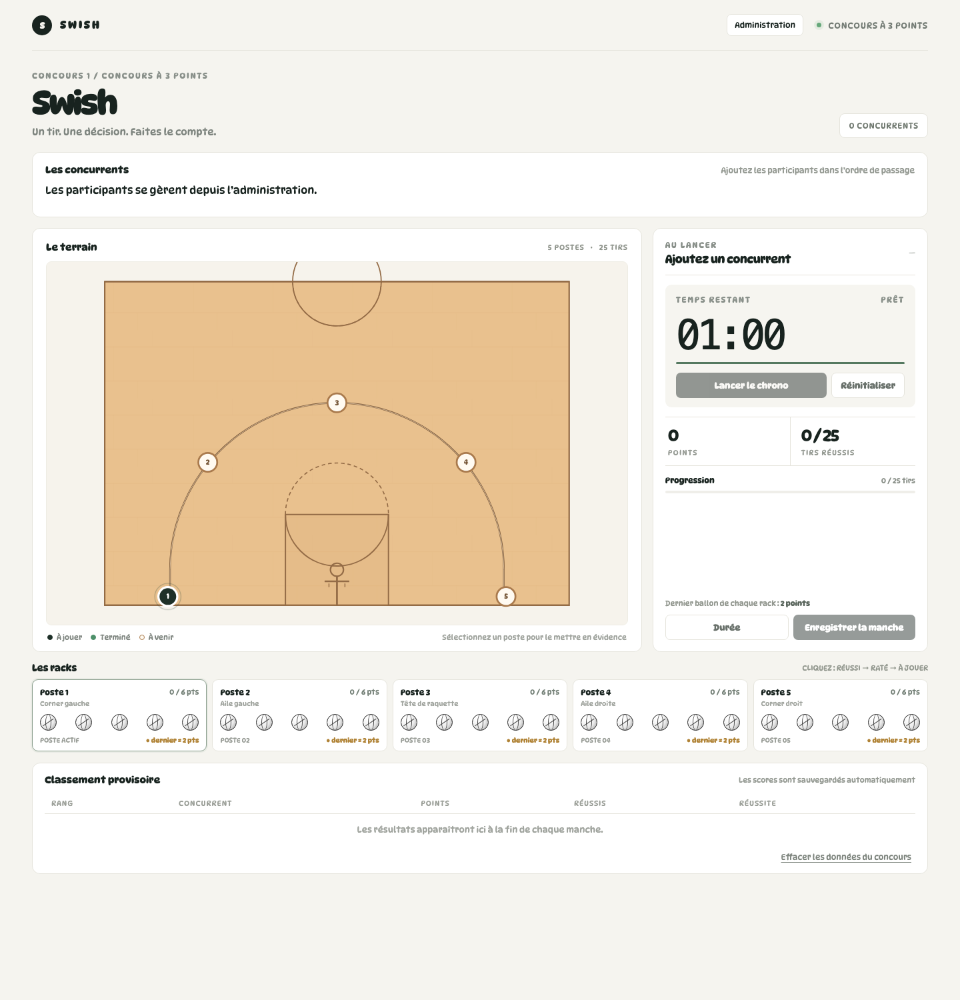

# Swish

Swish est une plateforme web de gestion de concours de tirs à trois points. Elle représente un demi-terrain interactif avec cinq postes et 25 tirs par participant, un chronomètre réglable, le suivi des réussites et des échecs, plusieurs concours, l’enregistrement des scores et la désignation des gagnants. L’application statique se déploie avec Docker Compose et s’intègre à Nginx Proxy Manager pour l’accès HTTPS.



## Déploiement avec Docker Compose et Nginx Proxy Manager

Prérequis : Docker Engine, Docker Compose et Nginx Proxy Manager connecté à un réseau Docker externe partagé. Vérifiez le nom du réseau NPM avec `docker network ls` (souvent `npm_default` ou `nginx-proxy-manager_default`). Le réseau peut être précisé dans `.env` avec `NPM_NETWORK=nom_du_reseau`. Le réseau externe doit déjà exister avant le démarrage.

Les deux fichiers sont automatiquement fusionnés par Docker Compose. L’override publie `127.0.0.1:8080` pour faciliter les tests depuis l’hôte ; Nginx Proxy Manager accède au conteneur via le réseau Docker, indépendamment de ce port. Sur le VPS, vous pouvez lancer le Compose principal seul : `docker compose -f docker-compose.yml up --build -d`.

```sh
docker compose up --build -d
docker compose ps
```

Dans Nginx Proxy Manager, créez un Proxy Host avec le nom de domaine souhaité, puis définissez le Forward Hostname / IP sur `swish` et le Forward Port sur `8080`. Activez le certificat SSL et Force SSL. Le port `8080` est uniquement joignable depuis le réseau Docker NPM.

Pour tester directement depuis le VPS, le fichier override publie `127.0.0.1:8080` :

```sh
curl http://127.0.0.1:8080/
```

```sh
docker compose logs -f swish
docker compose down
```

## Déploiement sur un VPS

1. Installer Docker Engine et Docker Compose sur le VPS.
2. Cloner le dépôt et entrer dans son dossier :

   ```sh
   git clone <URL_DE_VOTRE_DEPOT_GITHUB> swish
   cd swish
   ```

3. Démarrer le service :

   ```sh
   docker compose -f docker-compose.yml up --build -d
   ```

4. Vérifier l’état du conteneur :

   ```sh
   docker compose -f docker-compose.yml ps
   docker inspect --format='{{.State.Health.Status}}' swish
   ```

L’application s’appuie sur Nginx embarqué dans l’image comme serveur de fichiers statiques ; Nginx Proxy Manager gère le nom de domaine et le HTTPS. HTTPS est nécessaire pour les fonctions cryptographiques Web Crypto utilisées par la page d’administration.

Pour mettre à jour après un push GitHub :

```sh
git pull
docker compose -f docker-compose.yml up --build -d
```

## GitHub Actions

Le workflow `.github/workflows/docker.yml` vérifie la syntaxe JavaScript, construit l’image Docker et effectue un test HTTP de santé à chaque pull request et push sur `main` ou un tag `v*`.

Pour publier le projet sur GitHub, créez un dépôt vide, puis ajoutez son adresse comme remote et poussez la branche `main` :

```sh
git init -b main
git add index.html Dockerfile docker-compose.yml docker-compose.override.yml .dockerignore .gitignore .env.example .github/workflows/docker.yml README.md screenshots/swish.png
git commit -m "Rename app to Swish"
git remote add origin <URL_DE_VOTRE_DEPOT_GITHUB>
git push -u origin main
```

## Stockage et administration

Les concours, participants et résultats sont sauvegardés dans le `localStorage` du navigateur : ils persistent sur le même navigateur, mais ne sont ni partagés entre appareils ni sauvegardés sur le VPS. Le mot de passe d’administration est également configuré et stocké localement ; il protège seulement l’affichage de l’interface sur cet appareil, pas les données de l’application contre un accès direct. Cette version statique ne fournit pas d’authentification serveur ni de sauvegarde centralisée. Pour un usage multi-utilisateur ou des données sensibles, ajoutez un backend avec authentification et base de données avant de publier l’administration sur Internet.
